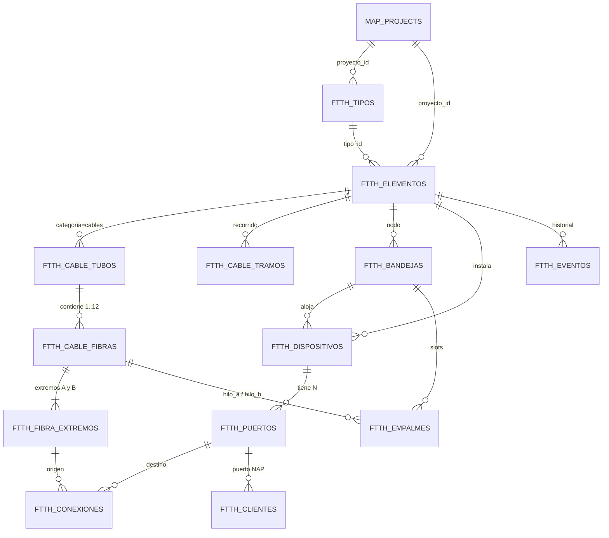

# Diseño de la Capa Lógica — Topología y Conectividad

**Proyecto:** FiberMap Táchira / MapOlt C.A. (`ema/`)
**Tipo de documento:** propuesta de arquitectura de datos + plan por fases
**Estado:** borrador para revisión
**Alcance:** **no modifica código de aplicación**. Es el insumo de las fases de implementación posteriores.

## Estado de implementación (2026-09-18)

| Fase | Estado | Qué quedó en el código |
|---|---|---|
| F2 Hilos | ✅ implementada | `backend/app/models/ftth_logica.py`, `backend/app/routers/ftth_logica.py`, `frontend/js/ftth-hilos.js`, `frontend/css/hilos.css`, pestaña «Hilos» en `frontend/index.html` |
| F3 Nodo (backend) | ✅ implementada | Tablas `ftth_bandejas`, `ftth_dispositivos`, `ftth_puertos` + DTO `GET /api/elementos/{id}/nodo` + `POST /bandejas` + `POST /dispositivos` + `GET /puertos` |
| F3 Nodo (frontend) | ✅ implementada | `frontend/js/ftth-diagrama.js`, `frontend/css/diagrama.css`, modal `#ftth-diagrama-modal`, clic izquierdo en la caja y acción «Abrir Diagrama Lógico» en el menú contextual |
| F1 PostGIS | ⏳ pendiente | — |
| F2.5 Ductos y postes | ⏳ pendiente | — |
| F4 Empalmes | ⏳ pendiente | Las bandejas ya tienen posiciones (slots) y los hilos ya tienen extremos anclados |
| F5 Potencia / trazado | ⏳ pendiente | — |
| F6 Clientes | ⏳ pendiente | — |

**Suite de pruebas** (ejecutar desde `ema/`):

```powershell
cd backend
python scripts/diagnostico_capa_logica.py      # estado de la BD (solo lectura)
python scripts/prueba_capa_logica.py           # F2 backend: materialización e idempotencia
python scripts/prueba_nodo.py                  # F3 backend: bandejas, dispositivos, puertos, DTO
python scripts/prueba_frontend_hilos.py        # F2 frontend: HTML servido y estáticos
python scripts/prueba_frontend_diagrama.py     # F3 frontend: modal, clic y guardas
cd ..\frontend
node scripts/prueba_render_hilos.js            # render de la pestaña Hilos (DOM simulado)
node scripts/prueba_render_diagrama.js         # render del diagrama (DOM simulado)
```

> Nota: existen **dos intérpretes** en la máquina. El proyecto se ejecuta con el Python global
> (`C:\Users\Emanuelito\AppData\Local\Programs\Python\Python314\python.exe`, que tiene FastAPI 0.109).
> El `.venv` de `ema/` está **vacío** (solo `pip`) y no sirve para correr la app.

## Índice

0. [Resumen ejecutivo](#0-resumen-ejecutivo)
1. [Principio rector y contrato entre capas](#1-principio-rector-y-contrato-entre-capas)
2. [Estado actual verificado en el código](#2-estado-actual-verificado-en-el-código)
3. [Vocabulario normalizado (glosario)](#3-vocabulario-normalizado-glosario)
4. [Modelo de datos propuesto](#4-modelo-de-datos-propuesto)
5. [Diagrama Entidad-Relación (resumen)](#5-diagrama-entidad-relación-resumen)
6. [Invariantes y reglas de negocio](#6-invariantes-y-reglas-de-negocio)
7. [Contrato de API propuesto](#7-contrato-de-api-propuesto)
8. [Contrato de UI: del clic al diagrama](#8-contrato-de-ui-del-clic-al-diagrama)
9. [Plan de implementación por fases](#9-plan-de-implementación-por-fases)
10. [Riesgos y mitigaciones](#10-riesgos-y-mitigaciones)
11. [Decisiones abiertas (ADR)](#11-decisiones-abiertas-se-deben-cerrar-en-fase-0)
12. [Modo no destructivo: ordenar la lógica sin dañar el proyecto](#12-modo-no-destructivo-ordenar-la-lógica-sin-dañar-el-proyecto)
13. [Potencia óptica: niveles por punto del camino lógico](#13-potencia-óptica-niveles-por-punto-del-camino-lógico)
14. [Anexos](#14-anexos)

---

## 0. Resumen ejecutivo

El sistema se organiza en **dos capas con responsabilidades disjuntas**:

| | **Capa FÍSICA (geometría)** | **Capa LÓGICA (topología)** |
|---|---|---|
| Pregunta que responde | ¿**Dónde** está y cuánto mide? | ¿**Quién** está conectado con quién? |
| Primitivas | `Point` (poste, caja, splitter), `LineString` (cable, ducto) | registros de contención, puertos y uniones |
| Unidad mínima | el objeto en el mapa | **el hilo** (fibra individual) |
| Herramienta | PostGIS (`geometry`, SRID 4326, índice GiST) | tablas relacionales + llaves compuestas |
| Un cable es… | una línea visual que pasa por postes | un **contenedor anidado**: cable → *loose tubes* → hilos 1..N |
| Una caja es… | un `Point` clicable | un **nodo de interconexión**: bandejas, splitters, adaptadores, puertos |
| El clic sirve para… | capturar `lngLat` / el ID del objeto | abrir el **diagrama de conectividad** del nodo |

**Llave única de unión entre capas:** la PK `ftth_elementos.id` (el `box_id` que viaja en `properties.id` del Feature GeoJSON). *No se crea un identificador paralelo.*

**Regla de oro del diseño:**
> La capa física **nunca** guarda continuidad óptica. La capa lógica **nunca** guarda geometría.
> La única intersección permitida es el ID del elemento y, opcionalmente, la longitud de un tramo.

**Qué existe hoy:** la capa física está implementada (aplanada en columnas `lat`/`lon`/`coords_json`, sin PostGIS real) y la *semántica* de hilos vive solo como texto en las plantillas (`looses`, `fibras`, `fibrasLoose`). La capa lógica **no existe**: cero tablas de tubos, hilos, puertos, empalmes, continuidad o trazado.

---

## 1. Principio rector y contrato entre capas

### 1.1 Responsabilidades

| Responsabilidad | Capa dueña | Ejemplo |
|---|---|---|
| Posición, recorrido, longitud | Física | "el cable C-014 va del poste 27 a la NAP-01 pasando por 4 postes" |
| Anclaje de un objeto a otro objeto | Física | `poste_ref_id`: la caja cuelga del poste |
| Cuántos hilos tiene un cable y cómo se llaman | Lógica | "tubo 3, hilo 7 → posición global 31, color rojo" |
| Qué hilo se empalma con cuál y en qué bandeja | Lógica | "empalme E-881: hilo 31 de C-014 ↔ hilo 5 de C-027" |
| Qué puerto alimenta a un cliente | Lógica | "puerto OUT-4 del splitter 1x8 de la NAP-01" |
| Atenuación acumulada de extremo a extremo | Lógica (derivada) | "OLT → cliente = 21.4 dB" |

### 1.2 Contrato de frontera (obligatorio)

1. `ftth_elementos.id` es el **único** identificador compartido. En el frontend se expone como `properties.id` y se usará como `box_id` al abrir el diagrama.
2. Toda tabla nueva de la capa lógica lleva `proyecto_id` (para aislar proyectos igual que `ftth_tipos` y `ftth_elementos`) **y** una FK en cascada a `ftth_elementos`.
3. **Cascada:** eliminar un elemento borra su contenido lógico (`ON DELETE CASCADE`). Mover un elemento (`PUT /api/elementos/{id}` con `lat/lon`) **no** afecta la lógica.
4. La lógica **jamás** altera el GeoJSON de `/api/elementos/todos`. Si una fase cambia ese contrato, se considera *breaking change* y requiere versionado.
5. `lat` / `lon` / `coords_json` se mantienen como fuente de compatibilidad. Si se habilita PostGIS, `geometry` es **derivada** de ellos (nunca al revés).

---

## 2. Estado actual verificado en el código

Evidencia recolectada para justificar el plan (rutas relativas a `ema/`):

| Tema | Hallazgo | Evidencia |
|---|---|---|
| Almacenamiento espacial | Columnas planas: `lat`/`lon` (`Float`), `coords_json` (`JSON`) para líneas | `backend/app/models/ftth_models.py:36-39` |
| PostGIS | Explícitamente **no usado** en los modelos | `backend/app/models/spatial.py:1` |
| Motor por defecto | **SQLite** (`tachira_maps.db`) | `backend/app/database.py:8` |
| PostGIS disponible | Imagen `postgis/postgis:15-3.3` declarada pero no conectada | `docker-compose.yml:5`, `README.md:12` |
| Vínculo entre objetos | Solo `poste_ref_id` (FK autorreferencial) | `backend/app/models/ftth_models.py:42` |
| GeoJSON de salida | `Point` desde `lat/lon`; `LineString` desde `coords_json` | `backend/app/routers/ftth_elementos.py:104-132` |
| API de elementos | Solo `POST /`, `GET /todos`, `PUT /{id}`, `DELETE /{id}` | `backend/app/routers/ftth_elementos.py:24,50,65,95` |
| Semántica de cable | La plantilla ya modela `looses`, `fibras`, `fibrasLoose`, `perfil` — pero como **texto de plantilla**, no como instancia | `frontend/js/ftth-tipos.js:113-124` |
| Semántica de splitter | La plantilla tiene `entradas`, `salidas`, `relacion_division`, `balanceado` — sin puertos direccionables | `frontend/js/ftth-tipos.js:203-213` |
| Interacción del mapa | `_bindLayerInteractions` solo enlaza `contextmenu`, `mouseenter`, `mouseleave` | `frontend/js/ftth-mapa.js:159-173` |
| Clic izquierdo | `handleMapClick` solo reacciona a modo *colocación* o *mover*: **el clic en una caja no abre nada** | `frontend/js/ftth-mapa.js:451-529` |
| Apertura del modal actual | Vía **clic derecho → menú contextual → "Propiedades"** | `frontend/js/ftth-mapa.js:735` |
| Modal actual | Propiedades genéricas con pestañas `info / historial / fotos / tareas` | `frontend/js/ftth-mapa.js:868-982`, `frontend/index.html:1245-1320` |
| Pestaña Historial | Llama a `GET /api/elementos/{id}/historial` → **endpoint inexistente**; siempre muestra "Sin historial" | `frontend/js/ftth-mapa.js:1046-1073` |
| Pestaña Fotos | Llama a `GET /api/elementos/{id}/fotos` → **endpoint inexistente** | `frontend/js/ftth-mapa.js:1075-1090` |
| Búsqueda de topología | `topolog|conectividad|connectivity|adjacency` → **0 resultados** | búsqueda global |
| Búsqueda de tubos | `buffer_tube|bufferTube|tubo|holgad` → **0 resultados** | búsqueda global |

### 2.1 Brecha identificada (lo que falta)

1. **Contención inexistente:** no hay forma de saber que el cable `C-014` tiene 12 tubos de 12 hilos ni cuál es el hilo 31.
2. **Puertos inexistentes:** `splitter_interno: '1x16 PLC'` y `capacidad_puertos: '16 Puertos'` son cadenas de texto; no se puede reservar ni ocupar el puerto 7.
3. **Uniones inexistentes:** no hay empalmes, patches ni trazado; por lo tanto no hay respuesta a "¿qué alimenta esta NAP?".
4. **Sin puerta de entrada:** el clic sobre la caja no se intercepta y no existe modal de diagrama.
5. **Sin lugar donde anclar geometría avanzada:** al no existir *tramos*, la línea del cable no se puede partir lógicamente en segmentos entre nodos.

---

## 3. Vocabulario normalizado (glosario)

Se fija un único término por concepto para que el modelo, la API y la UI no diverjan.

| Término | Definición operativa | Entidad |
|---|---|---|
| **Elemento** | Objeto colocado en el mapa (poste, caja, cable, ducto, splitter, OLT…). Es la bisagra entre capas. | `ftth_elementos` |
| **Tramo** | Segmento de un cable entre dos nodos consecutivos (dos cajas, o caja y poste de amarre). Es el "puente" entre la línea física y la lógica. | `ftth_cable_tramos` |
| **Cable** | Elemento `categoria='cables'` con geometría LineString. Contenedor físico de tubos. | `ftth_elementos` |
| **Loose / Tubo holgado** | Tubo dentro del cable que agrupa un conjunto de hilos. Numeración `1..looses`. | `ftth_cable_tubos` |
| **Hilo / Fibra** | Fibra individual. Identidad lógica: `(cable_id, tubo_no, hilo_no_en_tubo)` y posición global `1..N`. | `ftth_cable_fibras` |
| **Extremo de hilo** | Cada uno de los dos finales de un hilo (`A` y `B`). Es donde vive la conectividad. | `ftth_fibra_extremos` |
| **Nodo** | Elemento que interconecta (`cajanap`, `manga`, `odf`, `armario`, `olt`). | `ftth_elementos` |
| **Bandeja** | Bandeja de empalme dentro de un nodo, con posiciones (slots) numeradas. | `ftth_bandejas` |
| **Dispositivo** | Aparato instalado dentro de un nodo: splitter, adaptador/WDM, pigtail, switch. | `ftth_dispositivos` |
| **Puerto** | Punto de conexión direccionable de un dispositivo (`IN`/`OUT`/`BIDI`), con conector y posición. | `ftth_puertos` |
| **Empalme** | Unión permanente hilo↔hilo dentro de una bandeja (fusión o mecánica), en una posición (slot). | `ftth_empalmes` |
| **Conexión** | Unión desmontable hilo↔puerto o puerto↔puerto (pigtail, jumper, conectorizado directo). | `ftth_conexiones` |
| **Uso de cliente** | Asignación de un puerto de salida (NAP) a un suscriptor y su ONU. | `ftth_clientes` |
| **Trazado** | Camino óptico completo entre dos puntos, con atenuación acumulada. Es un resultado calculado, no una tabla. | *(derivado)* |
| **box_id** | Nombre de trabajo del `ftth_elementos.id` cuando el frontend lo usa para abrir el diagrama. | `ftth_elementos.id` |

> Nota de nomenclatura: se mantiene el prefijo `ftth_` y el uso de `proyecto_id`, `categoria` (string) y `propiedades_instancia` (JSON) ya establecidos en `ftth_models.py`.

---

## 4. Modelo de datos propuesto

### 4.0 Criterios de diseño aplicados

1. **Anidamiento explícito:** cable → tubo → hilo. Nada se deduce por convención de texto.
2. **Los puertos son ciudadanos de primera clase:** un splitter 1x16 son 17 filas en `ftth_puertos` (1 IN + 16 OUT), no una cadena `'1x16 PLC'`.
3. **Integridad referencial real (FK), no polimorfismo:** se prefieren dos tablas (`empalmes`, `conexiones`) con FK válidas antes que una tabla polimórfica flexible pero sin integridad.
4. **Idempotencia:** toda materialización (hilos, puertos) debe poder re-ejecutarse sin duplicar.
5. **Numeración determinista:** el nombre de un hilo se puede reconstruir desde sus claves, sin leer texto libre.

### 4.1 Contención del cable



#### `ftth_cable_tubos` (loose tubes)

| Columna | Tipo | Restricción | Nota |
|---|---|---|---|
| `id` | Integer | PK | |
| `proyecto_id` | Integer | FK `map_projects.id` CASCADE | Aislamiento por proyecto |
| `elemento_id` | Integer | FK `ftth_elementos.id` CASCADE | El cable contenedor |
| `tubo_no` | Integer | UNIQUE(`elemento_id`,`tubo_no`) | 1..`looses` |
| `color` | String(20) | | Código TIA-598 (Azul, Naranja, Verde…) |
| `capacidad_fibras` | Integer | | Normalmente 12; permite cables mixtos |
| `etiqueta` | String(100) | nullable | Texto impreso en el tubo |

#### `ftth_cable_fibras` (hilos)

| Columna | Tipo | Restricción | Nota |
|---|---|---|---|
| `id` | Integer | PK | |
| `proyecto_id` | Integer | FK `map_projects.id` CASCADE | |
| `elemento_id` | Integer | FK `ftth_elementos.id` CASCADE | Cable al que pertenece |
| `tubo_id` | Integer | FK `ftth_cable_tubos.id` CASCADE | Contenedor inmediato |
| `hilo_no_en_tubo` | Integer | UNIQUE(`tubo_id`,`hilo_no_en_tubo`) | 1..12 |
| `hilo_global_no` | Integer | UNIQUE(`elemento_id`,`hilo_global_no`) | Posición 1..144 para reportes |
| `color` | String(20) | | Código TIA-598 del hilo |
| `estado` | String(20) | default `libre` | `libre` / `empalmado` / `conectado` / `reservado` / `averiado` |
| `perfil` | String(30) | nullable | Copiado de la plantilla (G.652D, G.657A2…) |

> `estado` es un **cache derivado** de empalmes/conexiones; se recalcula al crear o borrar uniones. Facilita filtros rápidos ("hilos libres en este tramo") sin recursión.

#### `ftth_fibra_extremos`

| Columna | Tipo | Restricción | Nota |
|---|---|---|---|
| `id` | Integer | PK | |
| `fibra_id` | Integer | FK `ftth_cable_fibras.id` CASCADE | |
| `extremo` | String(1) | UNIQUE(`fibra_id`,`extremo`) | `A` o `B` |
| `nodo_id` | Integer | FK `ftth_elementos.id` SET NULL, nullable | Caja/manga donde termina |
| `tramo_id` | Integer | FK `ftth_cable_tramos.id` SET NULL, nullable | Tramo asociado |
| `bandeja_id` | Integer | FK `ftth_bandejas.id` SET NULL, nullable | Bandeja que lo recibe |
| `holgura_m` | Float | nullable | Reserva de hilo (slack) |

**Decisión de diseño (justificada):** los extremos se **materializan** en lugar de derivarse de la geometría. Motivo: en la capa física actual el cable solo guarda los puntos por los que pasa (`coords_json`) y no declara en qué caja *termina* cada hilo; derivarlo obligaría a adivinar. Con extremos explícitos, el grafo se recorre hilo→extremo→unión→extremo→hilo sin ambigüedad, y el anclaje a la geometría queda en `nodo_id`/`tramo_id`.

#### `ftth_cable_tramos` (puente físico-lógico)

| Columna | Tipo | Restricción | Nota |
|---|---|---|---|
| `id` | Integer | PK | |
| `proyecto_id` | Integer | FK `map_projects.id` CASCADE | |
| `elemento_id` | Integer | FK `ftth_elementos.id` CASCADE | Cable |
| `orden` | Integer | UNIQUE(`elemento_id`,`orden`) | 1..N a lo largo del recorrido |
| `nodo_origen_id` | Integer | FK `ftth_elementos.id` SET NULL | |
| `nodo_destino_id` | Integer | FK `ftth_elementos.id` SET NULL | |
| `coords_json` | JSON | nullable | Subconjunto de puntos del LineString |
| `longitud_m` | Float | nullable | Calculada (ST_Length/geo) o manual |

### 4.2 Nodo de interconexión (interior de la caja)

#### `ftth_bandejas`

| Columna | Tipo | Restricción | Nota |
|---|---|---|---|
| `id` | Integer | PK | |
| `proyecto_id` | Integer | FK `map_projects.id` CASCADE | |
| `elemento_id` | Integer | FK `ftth_elementos.id` CASCADE | La caja/manga/ODF |
| `bandeja_no` | Integer | UNIQUE(`elemento_id`,`bandeja_no`) | 1..N |
| `tipo` | String(20) | default `empalme` | `empalme` / `paso` / `splitter` / `mixta` |
| `slots` | Integer | default 12 | Capacidad de posiciones de empalme |
| `etiqueta` | String(100) | nullable | |

#### `ftth_dispositivos` (splitters, adaptadores, WDM, pigtails)

| Columna | Tipo | Restricción | Nota |
|---|---|---|---|
| `id` | Integer | PK | |
| `proyecto_id` | Integer | FK `map_projects.id` CASCADE | |
| `elemento_id` | Integer | FK `ftth_elementos.id` CASCADE | Nodo que lo aloja |
| `bandeja_id` | Integer | FK `ftth_bandejas.id` SET NULL, nullable | Bandeja donde va montado |
| `tipo_id` | Integer | FK `ftth_tipos.id` SET NULL, nullable | **Reutiliza el catálogo de plantillas** (categoría `splitter`) |
| `tipo` | String(30) | | `splitter` / `adaptador` / `wdm` / `pigtail` / `switch` |
| `serie` | String(100) | nullable | Número de serie / inventario |
| `division` | String(20) | nullable | `1x8`, `1x16`, `2x16`… |
| `puertos_in` | Integer | default 1 | |
| `puertos_out` | Integer | | N del splitter o del panel de adaptadores |
| `atenuacion_db` | Float | nullable | Atenuación propia del dispositivo |
| `estado` | String(20) | default `operativo` | `operativo` / `reservado` / `averiado` |

> Ventaja de `tipo_id`: el catálogo que ya existe (`ftth_tipos`, con `relacion_division`, `entradas`, `salidas`, `balanceado`) se convierte en el **origen de los puertos**: al instalar un dispositivo se generan sus puertos desde la plantilla. No se duplica el catálogo.

#### `ftth_puertos`

| Columna | Tipo | Restricción | Nota |
|---|---|---|---|
| `id` | Integer | PK | |
| `proyecto_id` | Integer | FK `map_projects.id` CASCADE | |
| `dispositivo_id` | Integer | FK `ftth_dispositivos.id` CASCADE | |
| `elemento_id` | Integer | FK `ftth_elementos.id` CASCADE | Denormalizado: consulta rápida "puertos de la caja X" |
| `direccion` | String(4) | UNIQUE(`dispositivo_id`,`direccion`,`puerto_no`) | `IN` / `OUT` / `BIDI` |
| `puerto_no` | Integer | | 1..N |
| `tipo_conector` | String(20) | nullable | `SC/APC`, `SC/UPC`, `LC/APC`… |
| `estado` | String(20) | default `libre` | `libre` / `ocupado` / `reservado` / `averiado` |
| `etiqueta` | String(100) | nullable | Serigrafía del puerto |

### 4.3 Uniones lógicas

#### `ftth_empalmes` (uniones permanentes hilo ↔ hilo)

| Columna | Tipo | Restricción | Nota |
|---|---|---|---|
| `id` | Integer | PK | |
| `proyecto_id` | Integer | FK `map_projects.id` CASCADE | |
| `elemento_id` | Integer | FK `ftth_elementos.id` CASCADE | Nodo donde se empalma |
| `bandeja_id` | Integer | FK `ftth_bandejas.id` CASCADE | |
| `slot` | Integer | UNIQUE(`bandeja_id`,`slot`) | Posición física 1..`slots` |
| `fibra_a_id` | Integer | FK `ftth_cable_fibras.id` | Hilo entrante |
| `fibra_b_id` | Integer | FK `ftth_cable_fibras.id` | Hilo saliente |
| `extremo_a` | String(1) | default `B` | Extremo usado del hilo A |
| `extremo_b` | String(1) | default `A` | Extremo usado del hilo B |
| `tipo` | String(20) | default `fusion` | `fusion` / `mecanico` / `conector` |
| `atenuacion_db` | Float | default 0.1 | Pérdida teórica (fusión ≈ 0.1 dB) |
| `perdida_medida_db` | Float | nullable | Del OTDR / certificación |
| `fecha` | DateTime | nullable | |
| `tecnico` | String(100) | nullable | |
| `observaciones` | Text | nullable | |

#### `ftth_conexiones` (uniones desmontables hilo ↔ puerto / puerto ↔ puerto)

| Columna | Tipo | Restricción | Nota |
|---|---|---|---|
| `id` | Integer | PK | |
| `proyecto_id` | Integer | FK `map_projects.id` CASCADE | |
| `elemento_id` | Integer | FK `ftth_elementos.id` CASCADE | Nodo donde ocurre |
| `tipo` | String(20) | | `pigtail` / `jumper` / `directo` / `cliente` |
| `extremo_id` | Integer | FK `ftth_fibra_extremos.id` SET NULL, nullable | Lado hilo |
| `puerto_a_id` | Integer | FK `ftth_puertos.id` SET NULL, nullable | Lado puerto |
| `puerto_b_id` | Integer | FK `ftth_puertos.id` SET NULL, nullable | Segundo puerto (jumper) |
| `atenuacion_db` | Float | default 0.3 | Conector ≈ 0.3 dB |
| `fecha` | DateTime | nullable | |
| `observaciones` | Text | nullable | |

> **Restricción de forma:** exactamente uno de dos escenarios →
> (a) `extremo_id` y `puerto_a_id` no nulos, `puerto_b_id` nulo (hilo↔puerto);
> (b) `puerto_a_id` y `puerto_b_id` no nulos, `extremo_id` nulo (puerto↔puerto).
> Se valida en el router, no en la UI.

#### `ftth_clientes` (fase 6)

| Columna | Tipo | Restricción | Nota |
|---|---|---|---|
| `id` | Integer | PK | |
| `proyecto_id` | Integer | FK `map_projects.id` CASCADE | |
| `codigo` | String(50) | indexado | Contrato / abonado |
| `nombre` | String(255) | | |
| `puerto_id` | Integer | FK `ftth_puertos.id` SET NULL | Puerto NAP asignado |
| `onu_serie` | String(100) | nullable | |
| `plan` | String(50) | nullable | |
| `estado` | String(20) | default `activo` | `activo` / `suspendido` / `baja` |

#### `ftth_eventos` (auditoría — resuelve las pestañas vacías)

| Columna | Tipo | Restricción | Nota |
|---|---|---|---|
| `id` | Integer | PK | |
| `proyecto_id` | Integer | FK `map_projects.id` CASCADE | |
| `elemento_id` | Integer | FK `ftth_elementos.id` CASCADE | |
| `accion` | String(100) | | "Empalme creado", "Hilo reservado"… |
| `entidad` | String(50) | nullable | `empalme`, `puerto`, `cliente`… |
| `entidad_id` | Integer | nullable | |
| `detalle` | JSON | nullable | Estado antes/después |
| `usuario` | String(100) | nullable | |
| `fecha` | DateTime | server_default now() | |

> Esta tabla habilita `GET /api/elementos/{id}/historial`, que el frontend **ya invoca hoy** (`frontend/js/ftth-mapa.js:1052`) y que actualmente no existe en el backend.

### 4.4 Geometría y compatibilidad (PostGIS opcional)

Objetivo: preparar la capa física para PostGIS **sin romper** el flujo actual ni la API de GeoJSON.

**Estrategia incremental, doble motor:**

| Paso | Acción | Compatibilidad |
|---|---|---|
| 1 | Añadir `ftth_elementos.geom geometry(Geometry, 4326)` + índice GiST (`ix_ftth_elementos_geom`) **solo si** `DATABASE_URL` apunta a PostgreSQL/PostGIS | En SQLite la columna no se crea; el código sigue usando `lat`/`lon`/`coords_json` |
| 2 | Poblar `geom` desde `lat`/`lon`/`coords_json` en el `PUT`/`POST` de `ftth_elementos.py` (misma función `feature_from_elemento`) | `feature_from_elemento` (`ftth_elementos.py:104-132`) **no cambia de firma ni de salida** |
| 3 | Usar `geom` para consultas que hoy no existen: *¿qué cajas están en este radio?*, *¿qué cables cruzan esta manzana?* | Consultas nuevas, endpoints nuevos (`/api/v1/layers/...`) |
| 4 | (Opcional, futuro) índices parciales y `ST_Intersects` para detectar cajas huérfanas de poste | No afecta la lógica |

**Principio de no ruptura:** el frontend sigue leyendo `geometry.type == 'Point'` / `'LineString'` con `coordinates`. La lógica consume IDs, no geometría. Por eso la migración a PostGIS es **ortogonal** a la capa lógica y puede ir antes, después o en paralelo.

**Longitudes:** `ftth_cable_tramos.longitud_m` se calcula con PostGIS cuando está disponible (`ST_Length(geom::geography)`), y con la fórmula de Haversine en Python cuando se corre sobre SQLite. Resultado idéntico en orden de magnitud.

### 4.5 Numeración de hilos y colores

Convención adoptada (coherente con las plantillas existentes: `looses`, `fibrasLoose`, `fibras`, `perfil` en `frontend/js/ftth-tipos.js:113-124`):

- **Nombre canónico de un hilo:** `C-014 T03 H07 (G31)` → cable, tubo 3, hilo 7 del tubo, posición global 31.
- **Hilo global:**
  - Caso simétrico (todos los tubos iguales): `hilo_global_no = (tubo_no - 1) * fibras_por_loose + hilo_no_en_tubo`
  - Caso mixto (tubos de distinta capacidad): se calcula acumulando las capacidades previas y se **almacena** en `hilo_global_no` (por eso la columna es persistente y no generada).
- **Código de color TIA-598-C** para tubos e hilos (12 colores: Azul, Naranja, Verde, Marrón, Pizarra, Blanco, Rojo, Negro, Amarillo, Violeta, Rosa, Aguamarina). Con más de 12 tubos, se repite el ciclo con marcas.
- **Validación de consistencia:** `Σ capacidad_fibras` de los tubos debe igualar `plantilla.propiedades.fibras`. Si no coincide, la materialización devuelve error explicativo en lugar de generar un inventario mentiroso.

### 4.6 Ductos, postes y otros contenedores físicos

**Contexto verificado hoy:**
- `colocarDucto` (`frontend/js/ftth-mapa.js:644-656`) guarda únicamente `coords_json`; no relaciona cables con el ducto.
- La plantilla de ducto (`frontend/js/ftth-tipos.js:142-149`) declara solo `nombre`, `codigo`, `tipo_ducto`, `desc`: **no hay capacidad ni subtubos**.
- `colocarElemento` (`frontend/js/ftth-mapa.js:588-595`) **nunca envía `poste_ref_id`**: el vínculo caja↔poste existe en el modelo (`ftth_models.py:42`) pero la UI no lo llena.

Consecuencia: hoy un ducto no contiene cables y una caja no cuelga de ningún poste. Por eso "los hilos no llegan **por lógica**" a postes ni ductos.

#### Contenedor de segundo nivel: ducto → cables

| Columna | Tipo | Restricción | Nota |
|---|---|---|---|
| `id` | Integer | PK | |
| `proyecto_id` | Integer | FK `map_projects.id` CASCADE | |
| `ducto_id` | Integer | FK `ftth_elementos.id` CASCADE | Elemento con `categoria='ducto'` |
| `cable_id` | Integer | FK `ftth_elementos.id` CASCADE | Elemento con `categoria='cables'` |
| `subtubo_no` | Integer | nullable | 1..n si el ducto tiene subtubos |
| `orden` | Integer | UNIQUE(`ducto_id`,`orden`) | Recorrido del ducto |
| `ocupacion_pct` | Float | nullable | % de la sección ocupada |
| `observaciones` | Text | nullable | |

Restricción: `UNIQUE(ducto_id, cable_id, orden)` para no duplicar el mismo cable en el mismo tramo del ducto.

#### Contenedor de soporte: postes y cámaras

| Columna | Tipo | Restricción | Nota |
|---|---|---|---|
| `id` | Integer | PK | |
| `proyecto_id` | Integer | FK `map_projects.id` CASCADE | |
| `elemento_id` | Integer | FK `ftth_elementos.id` CASCADE | Cable que pasa |
| `orden` | Integer | UNIQUE(`elemento_id`,`orden`) | 1..N a lo largo del recorrido |
| `soporte_id` | Integer | FK `ftth_elementos.id` SET NULL | Poste, cámara o buzón |
| `tipo` | String(20) | default `paso` | `amarre` / `paso` / `reserva` / `camara` |
| `holgura_m` | Float | nullable | Reserva de cable en el poste (no es pérdida óptica) |
| `altura_m` | Float | nullable | Altura de sujeción |

#### Extensión de plantillas **sin migración**

Los atributos nuevos de ducto (`capacidad_cables`, `subtubos`, `diametro_mm`) y de poste (`tipo_soporte`, `permite_reserva`) se añaden **dentro de `ftth_tipos.propiedades` (JSON)**, igual que hoy viven `material`, `altura_m`, `looses`, `fibras`. Es un campo JSON: **no requiere ALTER TABLE ni migración de datos**.

#### Roles por categoría (quién conmuta hilos y quién no)

| Categoría | Rol físico | Rol lógico | ¿Conmuta hilos? | ¿Aporta pérdida óptica? |
|---|---|---|---|---|
| `poste` | Soporte puntual | Punto de paso / amarre | **No** | No (solo suma la longitud del tramo) |
| `ducto` | Canalización (`LineString`) | Contenedor de cables / subtubo | **No** | No |
| `cable` | `LineString` | Contenedor tubos → hilos | Es el propio hilo | Sí: 0.22 – 0.35 dB/km |
| `manga` | `Point` | Bandejas de empalme (pasante) | **Sí** (fusión) | Sí: ~0.1 dB por fusión |
| `cajanap` | `Point` | Empalmes + splitter + puertos | **Sí** | Sí: splitter 10.7–16.9 dB + 0.3 dB por conector |
| `odf` | `Point` | Bandejas + panel de adaptadores | **Sí** | Sí: ~0.3 dB por conector |
| `armario` / `olt` | `Point` | Origen PON / reparto | **Sí** | Define la potencia TX (no resta, aporta) |
| `splitter` | `Point` (fuera de caja) | División | **Sí** | Su relación de división |
| `luminaria`, `switches` | — | **No participan** del camino óptico | No | No |

**Regla de oro #2 — la que evita que la lógica se vuelva ambigua:**
> Un **poste sostiene**, un **ducto encauza**, una **manga empalma**, una **caja distribuye**.
> Solo `manga`, `cajanap`, `odf`, `armario`, `olt` y `splitter` **conmutan** hilos.
> Si un hilo "desaparece" al pasar por un poste o un ducto, es un **error de captura**, no una característica del sistema.

---

## 5. Diagrama Entidad-Relación (resumen)

### 5.1 Lectura en texto (independiente del renderizador)

```
                    ┌──────────────────┐
                    │  map_projects     │
                    └────────┬─────────┘
                             │ proyecto_id
        ┌────────────────────┼──────────────────────────┐
        │                    │                          │
┌───────▼───────┐   ┌────────▼──────────┐      (todas las tablas lógicas)
│  ftth_tipos   │   │ ftth_elementos    │
│  (plantilla)  │──▶│  (box_id, geom)   │
└───────┬───────┘   └───┬───────────┬───┘
        │ tipo_id       │           │
        │               │           └──────────────────────────┐
        │               │                                      │
        │      ┌────────▼─────────┐                 ┌──────────▼────────┐
        │      │ ftth_cable_tubos │ (loose tubes)   │  ftth_bandejas    │
        │      └────────┬─────────┘                 └────┬─────────┬────┘
        │               │ tubo_id                         │         │
        │      ┌────────▼──────────┐            ┌─────────▼───────┐ │
        │      │ ftth_cable_fibras │ (hilos)    │ ftth_dispositivos│ │
        │      └────┬────────┬─────┘            │ (tipo_id ───────┼─┘
        │           │        │                  └────────┬────────┘
        │           │        │                           │
        │  ┌────────▼──────┐ │                    ┌──────▼────────┐
        │  │ftth_fibra_    │ │                    │ ftth_puertos  │
        │  │extremos (A/B) │ │                    └──┬─────────┬──┘
        │  └────┬──────────┘ │                       │         │
        │       │            └──────────┐            │         │
        │       │                       │            │         │
        │  ┌────▼──────────┐     ┌──────▼─────────┐  │  ┌──────▼───────┐
        │  │ftth_conexiones│     │ ftth_empalmes  │◀─┘  │ ftth_clientes│
        │  └───────────────┘     │ (slot, bandeja)│     └──────────────┘
        │                        └────────────────┘
        │
   ┌────▼──────────────┐        ┌────────────────┐
   │ftth_cable_tramos  │        │  ftth_eventos  │  (historial / auditoría)
   │(puente físico-    │        └────────────────┘
   │ lógico)           │
   └───────────────────┘
```

### 5.2 Inventario de entidades

| Entidad | Estado | Fase | Propósito en una línea |
|---|---|---|---|
| `map_projects` | **existe** | — | Proyecto; raíz de aislamiento (`proyecto_id`) |
| `ftth_tipos` | **existe** | — | Plantilla con `propiedades` JSON (origen de la materialización) |
| `ftth_elementos` | **existe** | — | Objeto en el mapa; aquí vive el `box_id` y la geometría |
| `ftth_carpetas`, `ftth_carpeta_elementos` | **existe** | — | Organización jerárquica del inventario |
| `ftth_cable_tubos` | nueva | F2 | Loose tubes del cable |
| `ftth_cable_fibras` | nueva | F2 | Hilos individuales y su numeración global |
| `ftth_fibra_extremos` | nueva | F2 | Extremos A/B; ancla de la conectividad |
| `ftth_cable_tramos` | nueva | F1/F2 | Segmentos entre nodos; puente físico-lógico |
| `ftth_bandejas` | nueva | F3 | Bandejas y slots dentro del nodo |
| `ftth_dispositivos` | nueva | F3 | Splitters/adaptadores instalados |
| `ftth_puertos` | nueva | F3 | Puertos direccionables IN/OUT/BIDI |
| `ftth_empalmes` | nueva | F4 | Unión permanente hilo↔hilo por slot |
| `ftth_conexiones` | nueva | F4 | Unión desmontable hilo↔puerto / puerto↔puerto |
| `ftth_ducto_cables` | nueva | F2.5 | Ducto como contenedor de cables (subtubo, ocupación) |
| `ftth_puntos_paso` | nueva | F2.5 | Poste/cámara como soporte del cable (amarre, paso, reserva) |
| `ftth_potencias` | nueva | F5 | Mediciones reales (TX, RX, OTDR) — nunca teóricas |
| `ftth_clientes` | nueva | F6 | Suscriptor sobre puerto NAP |
| `ftth_eventos` | nueva | F3/F6 | Historial (habilita pestaña existente) |

### 5.3 Índices recomendados

| Tabla | Índice | Motivo |
|---|---|---|
| `ftth_cable_fibras` | (`elemento_id`, `hilo_global_no`) | Listar hilos de un cable en orden |
| `ftth_cable_fibras` | (`tubo_id`, `hilo_no_en_tubo`) | Anidamiento y unicidad |
| `ftth_cable_fibras` | (`proyecto_id`, `estado`) | Reporte "hilos libres" |
| `ftth_fibra_extremos` | (`nodo_id`, `extremo`) | Qué hilos terminan en esta caja |
| `ftth_empalmes` | (`bandeja_id`, `slot`) | Dibujar la bandeja |
| `ftth_empalmes` | (`fibra_a_id`), (`fibra_b_id`) | Recorrer continuidad |
| `ftth_puertos` | (`elemento_id`, `estado`) | Puertos libres de la NAP |
| `ftth_conexiones` | (`extremo_id`), (`puerto_a_id`), (`puerto_b_id`) | Trazado y ocupación |
| `ftth_elementos` | GiST(`geom`) *si PostGIS* | Consultas espaciales |

---

## 6. Invariantes y reglas de negocio

Estas reglas son la **especificación de validación** de la capa lógica. Cada una debe tener un mensaje de error claro para el técnico.

### 6.1 Contención

| # | Invariante | Implementación sugerida | Mensaje al usuario |
|---|---|---|---|
| I1 | `Σ capacidad_fibras` de los tubos == `plantilla.propiedades.fibras` | Validación en materialización | "El cable declara 144 hilos pero los tubos suman 132" |
| I2 | `hilo_global_no` es único por cable y va de 1 a N sin huecos | Constraint UNIQUE + verificación en materialización | — |
| I3 | Un cable debe tener al menos 1 tubo para poder materializar hilos | Precondición del endpoint | "Configura los tubos antes de generar hilos" |
| I4 | No se puede reducir el número de tubos si ya existen empalmes sobre sus hilos | Validación al editar | "Hay hilos empalmados en el tubo 5" |

### 6.2 Conectividad

| # | Invariante | Implementación sugerida | Mensaje al usuario |
|---|---|---|---|
| I5 | Cada extremo de hilo acepta **como máximo una** unión (empalme o conexión) | Verificación en POST de empalme/conexión | "El extremo B del hilo 31 ya está empalmado en la Manga M-3" |
| I6 | Un hilo no puede empalmarse consigo mismo | `fibra_a_id != fibra_b_id` | "No puedes empalmar un hilo con él mismo" |
| I7 | Los dos hilos de un empalme deben pertenecer a **cables distintos** o ser tubos distintos (fusión de hilo con hilo del mismo cable solo en casos de empalme de reparación) | Regla configurable; por defecto, avisar | Advertencia no bloqueante |
| I8 | Un `slot` de bandeja no se repite (una posición = un empalme) | UNIQUE(`bandeja_id`,`slot`) | "La posición 3 de la bandeja 1 ya está ocupada" |
| I9 | Un puerto no puede tener más de una conexión activa | Verificación en POST de conexión | "El puerto OUT-4 ya está ocupado" |
| I10 | Los hilos de un empalme deben tener su extremo anclado (`nodo_id`) al mismo nodo del empalme | Validación | "El hilo 31 de C-014 no termina en esta caja" |
| I11 | **Sin ciclos:** el recorrido desde un hilo no debe volver a él mismo | Recorrido con conjunto de visitados; error si reaparece | "Este empalme crearía un bucle óptico" |
| I12 | La atenuación acumulada no puede superar el presupuesto del proyecto (configurable, ej. 28 dB para GPON Clase B+) | Cálculo en `/trazado` + advertencia | "Presupuesto óptico excedido: 31.2 dB" |

### 6.3 Nodos y dispositivos

| # | Invariante | Implementación sugerida | Mensaje al usuario |
|---|---|---|---|
| I13 | Un splitter `1xN` genera exactamente 1 puerto `IN` y `N` puertos `OUT` | Materialización desde la plantilla (`entradas`, `salidas`) | — |
| I14 | No instalar más puertos que la `capacidad_puertos` declarada en la plantilla de la caja | Advertencia en UI/backend | "La NAP declara 8 puertos; el splitter 1x16 excede su capacidad" |
| I15 | Un cliente ocupa un solo puerto NAP | UNIQUE(`puerto_id`) filtrado por `estado='activo'` | "Ese puerto ya tiene abonado" |
| I16 | La suma de conexiones de un splitter es coherente: cada `OUT` con 1 hilo como máximo | Validación | — |
| I17 | **Un poste o un ducto no conmutan hilos:** no pueden ser origen ni destino de un empalme o conexión | Validación en POST de uniones | "Un poste no puede empalmar hilos: usa una manga o una caja" |
| I18 | El mismo cable no puede estar dos veces en el mismo tramo del mismo ducto | UNIQUE(`ducto_id`,`cable_id`,`orden`) | "El cable C-014 ya está registrado en ese tramo del ducto" |
| I19 | Un cable físico (`categoria='cables'`) no puede colgar de un poste sin ser declarado en `ftth_puntos_paso` | Validación + advertencia en el DTO | "El cable pasa por el poste 27 pero no lo declara" |
| I20 | Una **medición** no puede escribirse en un campo de cálculo teórico (tablas separadas) | Diseño de esquema (§13.4) | — |
| I21 | Un hilo no puede reportarse como "llegado" a un nodo si su extremo no está anclado (`nodo_id` nulo) | Validación en el diagrama | "El hilo 31 del C-014 no tiene extremo anclado en esta caja" |
| I22 | Presupuesto óptico: avisar cuando `margen_restante_db < 3 dB` (margen de diseño) | Cálculo en `/potencia` | "Margen óptico insuficiente: 2.1 dB" |

### 6.4 Estado derivado

`ftth_cable_fibras.estado` y `ftth_puertos.estado` se recalculan así:

```
hilo:   sin extremos anclados                      → 'libre'
        extremo con empalme o conexión             → 'empalmado' / 'conectado'
        marca manual en propiedades_instancia      → 'reservado' / 'averiado' (manda)
puerto: sin conexiones                              → 'libre'
        con conexión de tipo 'cliente'              → 'ocupado'
        reserva explícita                           → 'reservado'
```

Regla: lo manual (reserva, avería) **prevalece** sobre lo derivado. Al borrar la unión, el estado vuelve a `libre` salvo que exista marca manual.

---

## 7. Contrato de API propuesto

Convenciones: se mantiene el prefijo `/api/` y el estilo de los routers existentes (`ftth_elementos.py`: `router = APIRouter(prefix="/api/elementos", tags=["ftth-elementos"])`; Pydantic `CamelCase` → `snake_case` en campos).

### 7.1 Endpoints por fase

| Fase | Método y ruta | Descripción |
|---|---|---|
| F2 | `POST /api/cables/{cable_id}/tubos` | Crear/reemplazar tubos (idempotente) |
| F2 | `POST /api/cables/{cable_id}/materializar-hilos` | Generar tubos+hilos desde la plantilla (`looses`, `fibrasLoose`, colores TIA-598) |
| F2 | `GET /api/cables/{cable_id}/hilos?estado=libre` | Árbol tubo→hilo con estado |
| F2 | `PUT /api/fibras/{fibra_id}` | Reservar / marcar avería / anclar extremo |
| F2 | `POST /api/cables/{cable_id}/tramos` | Definir tramos entre nodos |
| F3 | `GET /api/elementos/{elem_id}/nodo` | **DTO del diagrama** (ver 7.2) |
| F3 | `POST /api/elementos/{elem_id}/bandejas` | Crear bandeja |
| F3 | `POST /api/elementos/{elem_id}/dispositivos` | Instalar splitter/adaptador y generar sus puertos |
| F3 | `GET /api/elementos/{elem_id}/puertos?estado=libre` | Puertos libres del nodo |
| F3 | `GET /api/elementos/{elem_id}/historial` | **Habilita la pestaña ya existente en el frontend** |
| F3 | `GET /api/elementos/{elem_id}/fotos` | Ídem para la pestaña de fotos (`propiedades_instancia.fotos`) |
| F4 | `POST /api/empalmes` / `DELETE /api/empalmes/{id}` | Crear y borrar empalme con validación I5–I11 |
| F4 | `POST /api/conexiones` / `DELETE /api/conexiones/{id}` | Crear y borrar conexión |
| F4 | `POST /api/empalmes/validar` | Pre-validación sin persistir (para feedback en vivo en la UI) |
| F5 | `GET /api/elementos/{elem_id}/trazado?hasta={elem_id}` | Camino óptico + atenuación + advertencias |
| F5 | `GET /api/reportes/hilos-libres?proyecto_id=` | Reporte de ocupación por cable/tubo |
| F2.5 | `POST /api/ductos/{ducto_id}/cables` | Asignar cables al ducto (subtubo) |
| F2.5 | `POST /api/cables/{cable_id}/puntos-paso` | Registrar soportes (postes/cámaras) del cable |
| F2.5 | `GET /api/elementos/{elem_id}/ocupacion` | Qué cables/hilos pasan por un ducto o poste |
| F5 | `GET /api/elementos/{elem_id}/potencia?longitud_onda=&hasta=` | Niveles dBm por punto del camino lógico (§13.5) |
| F5 | `POST /api/potencias` | Registrar medición real (TX, RX, OTDR) |
| F5 | `GET /api/potencias?fibra_id=` | Histórico de mediciones de un hilo (evolución) |
| F6 | `POST /api/clientes` / `PUT /api/clientes/{id}` | Alta/baja de abonado sobre puerto NAP |

### 7.2 DTO del diagrama (`GET /api/elementos/{elem_id}/nodo`)

Es el **único payload que el frontend necesita** para dibujar el diagrama de una caja:

```json
{
  "nodo": {
    "box_id": 42,
    "categoria": "cajanap",
    "tipo_nombre": "Caja NAP 16P",
    "lat": 7.7669, "lon": -72.2250,
    "capacidad_puertos": 16,
    "estado": "Operativa"
  },
  "bandejas": [
    { "id": 7, "bandeja_no": 1, "tipo": "empalme", "slots": 12,
      "ocupados": 5,
      "empalmes": [
        { "id": 881, "slot": 3,
          "hilo_a": { "fibra_id": 501, "cable": "C-014", "tubo": 3, "hilo": 7, "global": 31, "color": "#f97316" },
          "hilo_b": { "fibra_id": 903, "cable": "C-027", "tubo": 1, "hilo": 5, "global": 5,  "color": "#3b82f6" },
          "tipo": "fusion", "atenuacion_db": 0.1 }
      ]
    }
  ],
  "dispositivos": [
    { "id": 12, "tipo": "splitter", "division": "1x8", "serie": "SN-88213",
      "atenuacion_db": 10.7, "bandeja_id": 7, "estado": "operativo" }
  ],
  "puertos": [
    { "id": 301, "dispositivo_id": 12, "direccion": "IN",  "puerto_no": 1, "tipo_conector": "SC/APC", "estado": "ocupado" },
    { "id": 302, "dispositivo_id": 12, "direccion": "OUT", "puerto_no": 1, "tipo_conector": "SC/APC", "estado": "ocupado", "cliente": "CLI-0042" }
  ],
  "hilos_que_terminan": [
    { "fibra_id": 501, "cable_id": 14, "cable": "C-014", "tubo": 3, "hilo": 7, "global": 31,
      "extremo": "B", "estado": "empalmado", "bandeja_id": 7 }
  ],
  "advertencias": [
    "3 puertos OUT del splitter 1x8 están libres",
    "El hilo global 12 del C-014 termina en la caja pero no tiene empalme (hilo al aire)"
  ]
}
```

**Notas de diseño del DTO:**
- `advertencias[]` es parte del contrato: la UI no calcula reglas de negocio.
- El DTO está **auto-contenido**: no requiere llamadas adicionales para pintar la caja.
- No incluye geometría: el diagrama es lógico.

---

## 8. Contrato de UI: del clic al diagrama

### 8.1 Flujo objetivo

```
clic izquierdo sobre la caja
        │
        ├─ ¿hay modo de colocación o modo mover activo?  → sí → comportamiento actual (no tocar)
        │
        └─ no → queryRenderedFeatures sobre 'ftth-labels-layer'
                 │
                 └─ props.categoria ∈ {cajanap, manga, odf, armario, olt, splitter}
                        │
                        └─ box_id = props.id
                             │
                             └─ GET /api/elementos/{box_id}/nodo
                                    │
                                    └─ abrir #ftth-diagrama-modal  (namespace FTTHDiagrama)
```

### 8.2 Puntos exactos de intervención (solo referencia; no se implementa en este documento)

| Archivo | Punto | Cambio previsto |
|---|---|---|
| `frontend/js/ftth-mapa.js:159-173` | `_bindLayerInteractions(map, layerIds)` | Añadir `map.on('click', layerId, handler)` para abrir el diagrama o el modal de propiedades según `categoria` |
| `frontend/js/ftth-mapa.js:451-529` | `handleMapClick` | Añadir guarda temprana: si `_modoActivo` o `_modoMover` están activos, el clic **no** abre el diagrama |
| `frontend/js/ftth-mapa.js:735` | menú contextual, acción `properties` | Añadir acción `diagrama` ("Abrir diagrama") para no romper el flujo actual de clic derecho |
| `frontend/index.html:1229+` | modales | Nuevo `#ftth-diagrama-modal` siguiendo la estructura del modal de propiedades |
| `frontend/index.html:13` | `<link>` de CSS | Añadir `css/diagrama.css?v=AAAA-MM-DD-diagrama` |
| `frontend/index.html:1361-1366` | `<script src>` | Añadir `js/ftth-diagrama.js?v=AAAA-MM-DD-diagrama` **después** de `ftth-mapa.js` |
| `frontend/js/app.js` / `ftth-iconos.js` | helpers | Reutilizar `FTTHIconos.imgHtml(categoria, size)` y `FTTHIconos.url(categoria)` para el diagrama |

### 8.3 Convenciones a respetar (extraídas del código actual)

1. **Namespace IIFE** con exposición global, igual que `FTTHMapa`, `FTTHTipos`, `FTTHIconos`: `const FTTHDiagrama = (() => { ... return {...}; })(); window.FTTHDiagrama = FTTHDiagrama;`
2. **Cache-buster por versión** en el `<script>`: el repo usa `?v=20260917-tipos-v6`, `?v=20260918-modos`.
3. **Construcción de URL con `apiUrl()`** (el helper vive en `ftth-mapa.js:46-53`); si `FTTHDiagrama` lo necesita, debe reutilizar el mismo criterio `origin` / fallback `http://127.0.0.1:8000`.
4. **Toast para feedback:** `FTTHTipos.showToast(mensaje, 'success'|'info'|'error')`.
5. **Escapado de HTML:** usar el patrón `escapeHtml(...)` ya presente antes de inyectar texto del servidor.
6. **Un solo modal activo:** cerrar el de propiedades al abrir el de diagrama (y viceversa) para evitar solapamientos de `z-index`.
7. **Render del diagrama:** SVG generado por JS (mismo enfoque que los íconos inline del `index.html`), **no** canvas, para permitir `title`, accesibilidad y clic por elemento.

### 8.4 Alcance visual propuesto del modal de diagrama

| Zona del modal | Contenido |
|---|---|
| Cabecera | Ícono del tipo + nombre + `box_id` + estado del nodo (`prop-header-badge`) |
| Columna izquierda | **Hilos que terminan aquí**: agrupados por cable → tubo, con color TIA-598 y estado |
| Centro | **Bandejas**: cada bandeja como panel con sus `slots`; cada slot ocupado dibuja el empalme (hilo A ↔ hilo B) |
| Columna derecha | **Dispositivos y puertos**: splitter 1xN con puertos IN/OUT, adaptadores, y ocupación por cliente |
| Pie | `advertencias[]` del DTO y botón "Ver trazado hacia la OLT" (F5) |
| Modo | F3: **solo lectura**. F4: edición (arrastrar hilo a slot, asignar puerto) |

---

## 9. Plan de implementación por fases

Criterio de secuenciación: **cada fase entrega valor utilizable por sí sola** y ninguna rompe lo existente. Las fases F1 y F2 pueden ir en paralelo con F3 si hay más de un desarrollador.

### Fase 0 — Decisiones y línea base (0.5 – 1 día)

| | Contenido |
|---|---|
| Objetivo | Congelar las decisiones que condicionan todo lo demás |
| Entregables | ADR-001 *(¿PostGIS obligatorio o dual SQLite/PostGIS?)*; ADR-002 *(extremos explícitos vs derivados)*; ADR-003 *(tablas separadas vs polimórfica)*; conteo real de elementos por proyecto como línea base |
| Criterio de aceptación | Los 3 ADR aprobados y registrados en este documento |
| Riesgo | Ninguno; es decisión, no construcción |

### Fase 1 — Refuerzo de la capa física (1 – 2 días)

| | Contenido |
|---|---|
| Objetivo | Dejar la geometría lista para PostGIS **sin cambiar la API** |
| Entregables | Columna `geom` + índice GiST condicionados a PostGIS; sincronización desde `lat`/`lon`/`coords_json`; `ftth_cable_tramos` con cálculo de longitud (PostGIS o Haversine) |
| Criterio de aceptación | `GET /api/elementos/todos?proyecto_id=X` devuelve **exactamente** el mismo GeoJSON que antes (mismo `type`, `coordinates`, `properties`); los elementos nuevos se guardan con `geom` poblado cuando hay PostGIS |
| Riesgo | Duplicidad de fuente de verdad geométrica → mitigar con regla "`geom` es derivada" y test de comparación |

### Fase 2 — Contención del cable (hilos) (2 – 4 días)

| | Contenido |
|---|---|
| Objetivo | Poder responder "¿qué es el hilo 31 del C-014?" |
| Entregables | `ftth_cable_tubos`, `ftth_cable_fibras`, `ftth_fibra_extremos`; endpoint idempotente de materialización desde la plantilla; `GET /api/cables/{id}/hilos`; nueva pestaña **"Hilos"** en el modal de propiedades actual con árbol tubo→hilo y filtro por estado |
| Criterio de aceptación | Crear un cable con plantilla `ADSS-144 / 12 looses / 12 fibras` genera **144** hilos con numeración global 1..144 y colores TIA-598; re-ejecutar la materialización **no duplica** filas; el árbol se ve en el modal sin recargar la página |
| Riesgo | Cables existentes sin plantilla completa (los `DEFAULT_DEFS` de `ftth-mapa.js:16-29` tienen `looses`/`fibras`) → mitigar con valores por defecto y mensaje guía |

### Fase 2.5 — Contenedores y soportes: ductos y postes (1 – 2 días)

| | Contenido |
|---|---|
| Objetivo | Que los hilos también "pasen" por ductos y postes **por lógica**, sin conmutar |
| Entregables | `ftth_ducto_cables` y `ftth_puntos_paso`; endpoints de asignación; atributos nuevos de plantilla dentro de `propiedades` (JSON): `capacidad_cables`, `subtubos`, `tipo_soporte`; vista "Ocupación del ducto" y "Cable en poste" en el modal de Propiedades |
| Criterio de aceptación | Un cable puede declararse dentro de un ducto con su subtubo y verse la ocupación; un cable declara sus postes de paso en orden; **si ninguno de los dos se usa, el mapa y la API se comportan igual que hoy** |
| Riesgo | Nadie llena estos datos (como pasa hoy con `poste_ref_id`) → mitigar con sugerencia automática: al dibujar un cable, proponer los postes y ductos más cercanos e incluir un botón "omitir" |

### Fase 3 — Nodo y diagrama (solo lectura) (3 – 5 días)

| | Contenido |
|---|---|
| Objetivo | Convertir la caja en un nodo navegable: **clic → diagrama** |
| Entregables | `ftth_bandejas`, `ftth_dispositivos`, `ftth_puertos`, `ftth_eventos`; `GET /api/elementos/{id}/nodo` (DTO 7.2); `GET /{id}/historial` y `GET /{id}/fotos` (resuelven pestañas ya existentes); `frontend/js/ftth-diagrama.js` + `frontend/css/diagrama.css` + `#ftth-diagrama-modal`; intercepción del clic en `ftth-mapa.js`; acción "Abrir diagrama" en el menú contextual |
| Criterio de aceptación | Un clic izquierdo sobre una `cajanap` abre el diagrama con sus bandejas, dispositivos y puertos; con un modo de colocación activo el clic **no** abre nada; clic derecho sigue abriendo Propiedades; la pestaña Historial deja de mostrar "Sin historial" cuando hay eventos |
| Riesgo | Colisión con el gesto de colocación/mover → mitigar con la guarda temprana en `handleMapClick` y prueba manual de los 4 modos (colocar punto, colocar ducto, mover, ninguno) |

### Fase 4 — Uniones: empalmes y conexiones (4 – 6 días)

| | Contenido |
|---|---|
| Objetivo | Declarar la continuidad óptica real: hilo↔hilo y hilo↔puerto |
| Entregables | `ftth_empalmes` y `ftth_conexiones`; validadores I5–I11 con mensajes claros; `POST /api/empalmes/validar`; UI de edición en el diagrama (seleccionar dos hilos → elegir bandeja y slot → confirmar); recálculo automático del `estado` de hilos y puertos |
| Criterio de aceptación | Un empalme entre el hilo 31 de C-014 y el hilo 5 de C-027 queda ocupando el slot 3 de la bandeja 1 y **ambos** hilos pasan a `empalmado`; intentar reutilizar el extremo o el slot devuelve error explicativo y **no** persiste; borrar el empalme devuelve los hilos a `libre` |
| Riesgo | Errores humanos de inventario → mitigar con pre-validación en vivo y con `ftth_eventos` para poder auditar |

### Fase 5 — Trazado y reportes (3 – 5 días)

| | Contenido |
|---|---|
| Objetivo | Responder preguntas de operación: "¿de dónde viene esta NAP?" y "¿cuánto presupuesto óptico queda?" |
| Entregables | `GET /api/elementos/{id}/trazado` (CTE recursiva); cálculo de atenuación acumulada (fibra + empalmes + conectores + splitters); **potencia por punto**: `ftth_potencias`, `GET /{id}/potencia` y semáforo dBm (§13); `GET /api/reportes/hilos-libres`; botón "Ver trazado" en el diagrama con resaltado del camino en el mapa |
| Criterio de aceptación | Desde la NAP-01 se obtiene el camino completo hasta la OLT con la pérdida acumulada y los dBm **en cada punto**; un camino con bucle es rechazado o marcado; si falta la longitud de un tramo o la potencia TX, el resultado se marca `parcial` / `solo_perdidas` en lugar de inventar valores; el reporte coincide con el conteo manual de hilos en un cable de prueba |
| Riesgo | Rendimiento de la recursión en PostgreSQL con muchos saltos → mitigar con índices de 5.3 y límite de profundidad |

### Fase 6 — Clientes y cierre del ciclo (3 – 5 días)

| | Contenido |
|---|---|
| Objetivo | Cerrar el ciclo comercial: de la OLT al abonado |
| Entregables | `ftth_clientes`; endpoints de alta/baja; vista de puerto ocupado con nombre de abonado; exportación CSV/GeoJSON de ocupación |
| Criterio de aceptación | Un cliente ocupa un puerto OUT y ese puerto cambia a `ocupado`; el reporte de hilos libres descuenta los asignados; dar de baja libera el puerto y libera el hilo |
| Riesgo | Datos personales (privacidad) → no exponer `ftth_clientes` en endpoints públicos del mapa |

### 9.1 Resumen de esfuerzo

La columna **Depende de** indica la fase que debe estar cerrada antes de empezar.

| Fase | Días (1 dev) | Depende de |
|---|---|---|
| F0 Decisiones | 0.5 – 1 | — |
| F1 Física / PostGIS | 1 – 2 | F0 |
| F2 Hilos | 2 – 4 | F0, (F1 opcional) |
| F2.5 Ductos y postes | 1 – 2 | F2 |
| F3 Nodo y diagrama | 3 – 5 | F0, (F2 recomendable) |
| F4 Empalmes | 4 – 6 | F2, F3 |
| F5 Trazado y potencia | 5 – 8 | F4 |
| F6 Clientes | 3 – 5 | F4 |
| **Total** | **19.5 – 33 días** | |

Intercalado obligatorio en cada fase: **test manual de no regresión** de colocar/mover/editar/eliminar elemento y de `GET /api/elementos/todos`.

---

## 10. Riesgos y mitigaciones

| # | Riesgo | Probabilidad | Impacto | Mitigación |
|---|---|---|---|---|
| R1 | Se rompe el contrato GeoJSON de `/api/elementos/todos` y el mapa deja de pintar | Media | Alto | Regla "no cambiar `feature_from_elemento`"; prueba de comparación de payload al cerrar cada fase |
| R2 | Doble motor (SQLite en desarrollo, PostGIS en producción) genera comportamiento distinto | Alta | Medio | SQL portable (CTE recursiva soportada por ambos); pruebas con las dos cadenas; `geom` opcional |
| R3 | Volumen de datos: 144 hilos × cientos de cables = cientos de miles de filas | Media | Medio | Índices de 5.3; materialización solo al confirmar el cable; paginación en `GET /hilos` |
| R4 | Elementos existentes sin tubos/hilos (inventario histórico) | Alta | Medio | Materialización retroactiva idempotente + indicador visual "sin hilos generados" |
| R5 | El clic izquierdo entra en conflicto con colocar/mover | Alta | Medio | Guarda temprana en `handleMapClick` (8.2) y pruebas de los 4 modos |
| R6 | Reglas de negocio filtradas a la UI (se pueden evadir) | Media | Alto | Todas las validaciones I1–I16 en el backend; la UI solo muestra mensajes |
| R7 | Sobrecarga visual del diagrama con 144 hilos y 16 puertos | Media | Medio | Vista por bandeja + filtros (por tubo, por estado) + conteos; no dibujar todo el nodo de una vez |
| R8 | Pérdida de trazabilidad de cambios manuales | Media | Bajo | `ftth_eventos` desde F3 |
| R9 | Un `poste_ref_id` inválido o cajas huérfanas rompen el anclaje de tramos | Media | Bajo | Tramos con `nodo_id` nullable y advertencia en el DTO |

---

## 11. Decisiones abiertas (se deben cerrar en Fase 0)

### ADR-001 — ¿PostGIS obligatorio o dual SQLite/PostGIS?

| Opción | Ventajas | Desventajas |
|---|---|---|
| **A. Dual (recomendada)** | No rompe el arranque local actual (`sqlite:///./tachira_maps.db`); permite PostGIS donde ya está disponible | Dos rutas de código en longitudes y consultas espaciales |
| B. PostGIS obligatorio | Una sola ruta; consultas espaciales completas | Rompe el arranque actual y exige `docker-compose up -d` para desarrollar |

*Recomendación:* **A**, con `geom` creada solo si el motor es PostgreSQL (ver 4.4).

### ADR-002 — Extremos de hilo: ¿explícitos o derivados?

| Opción | Ventajas | Desventajas |
|---|---|---|
| **A. Explícitos (`ftth_fibra_extremos`)** | Grafo sin ambigüedad; permite holgura y anclaje a bandeja; base para el trazado | 2 filas por hilo (144 hilos → 288 filas) |
| B. Derivados de la geometría/propiedades del cable | Menos filas | Obliga a adivinar en qué caja termina cada hilo; el trazado se vuelve heurístico |

*Recomendación:* **A** (justificación en 4.1).

### ADR-003 — Uniones: ¿tablas separadas o polimórfica?

| Opción | Ventajas | Desventajas |
|---|---|---|
| **A. `ftth_empalmes` + `ftth_conexiones` (recomendada)** | FK reales; integridad garantizada por la BD; consultas simples | Dos tablas y dos flujos de UI |
| B. Tabla única polimórfica `origen_tipo/origen_id` | Un solo flujo | Sin integridad referencial real; validaciones solo en código |

*Recomendación:* **A**.

### ADR-004 — Alcance inicial del diagrama

*Recomendación:* **solo lectura en F3**, edición en F4. Motivo: permite validar el DTO y la interacción del clic con riesgo bajo antes de habilitar escritura.

### ADR-005 — Presupuesto óptico del proyecto

Definir el valor de referencia para I12 (¿GPON Clase B+ = 28 dB? ¿con o sin margen de envejecimiento de 3 dB?). *Recomendación:* guardarlo en `map_projects` (o en `propiedades` del proyecto) para que sea configurable por proyecto, no una constante de código.

---

## 12. Modo no destructivo: ordenar la lógica sin dañar el proyecto

### 12.1 Respuesta corta

Sí. Todo el trabajo se hace **solo agregando**. Ni una columna existente se borra, se renombra ni cambia de tipo; ni una categoría (`poste`, `cajanap`, `manga`, `ducto`, `cables`, `odf`, `olt`, `splitter`, `armario`, `luminaria`, `switches`, `fusion`) se toca; ni un gesto del mapa (colocar, mover, clic derecho, Propiedades, eliminar) se altera. La capa lógica se **monta encima** de lo que ya existe y **se puede apagar**.

### 12.2 Los 7 compromisos de no ruptura

| # | Compromiso |
|---|---|
| C1 | **Solo aditivo:** columnas nuevas siempre `nullable`; columnas existentes intactas (`lat`, `lon`, `coords_json`, `poste_ref_id`, `propiedades`, `propiedades_instancia`) |
| C2 | **Categorías intactas:** no se renombra ninguna categoría ni se crean categorías nuevas |
| C3 | **Tablas nuevas, no modificadas:** las 14 tablas de la capa lógica son nuevas y cuelgan de `ftth_elementos.id` por FK |
| C4 | **Contrato GeoJSON intacto:** `feature_from_elemento` (`ftth_elementos.py:104-132`) no se toca; `/api/elementos/todos` responde igual |
| C5 | **Gestos intactos:** los 4 modos actuales (colocar punto, colocar ducto, mover, ninguno) siguen con el mismo comportamiento |
| C6 | **Todo lo nuevo es opcional:** si nadie usa el diagrama ni las potencias, la aplicación se comporta exactamente como hoy |
| C7 | **Reversible:** borrar las tablas nuevas devuelve el sistema al estado actual (se pierde la lógica capturada, nada más) |

### 12.3 Qué NO cambia (garantías por área)

| Área | Garantía |
|---|---|
| `ftth_elementos` (estructura) | Sin cambios; ninguna columna se elimina ni se altera |
| `ftth_elementos` (datos) | Ninguna fila se reescribe por la capa lógica |
| `ftth_tipos.propiedades` (JSON) | Los atributos nuevos (`capacidad_cables`, `subtubos`, `potencia_tx`) se **añaden dentro del JSON** → cero migración |
| `map_projects`, `ftth_carpetas`, `ftth_carpeta_elementos` | Sin cambios |
| Íconos, colores, etiquetas del mapa | Sin cambios |
| Modal de Propiedades | Solo se **añade** la pestaña "Hilos"; nada se quita ni se reordena |
| Motor de BD | SQLite actual sigue funcionando; PostGIS es opcional (§4.4) |

### 12.4 Cómo se enciende y se apaga (sin desplegar)

| Opción | Cómo | Invasividad |
|---|---|---|
| **A. Flag en `localStorage` por proyecto** (recomendada para empezar) | `fibermap-flags-<proyecto_id>` → `{"capa_logica": true, "diagrama": true, "potencias": true}` | **Cero** cambios en BD |
| B. Columna `propiedades` (JSON, nullable) en `map_projects` | `ALTER TABLE ADD COLUMN` (SQLite lo soporta sin reescribir datos) | Aditiva, una sola columna |

Regla: si el flag no existe o está en `false`, la UI **no** muestra nada nuevo. Secuencia segura: 1) se despliega todo apagado, 2) se enciende en un proyecto de prueba, 3) se enciende en producción cuando esté validado.

### 12.5 "Ordenar la lógica" = materializar el orden que ya está implícito

No hay que reordenar los datos del usuario: hay que **convertir en estructura** lo que hoy está en texto o implícito.

| Hoy | Después |
|---|---|
| Plantilla dice `looses: 12`, `fibrasLoose: 12` (texto) | 12 filas en `ftth_cable_tubos` |
| Plantilla dice `fibras: 144` | 144 filas en `ftth_cable_fibras`, numeradas 1..144 |
| `splitter_interno: '1x16 PLC'` (texto) | 1 dispositivo + 17 filas en `ftth_puertos` |
| `capacidad_fusion: '48 hilos'` (texto) | Bandejas con `slots` y ocupación real |
| El cable "pasa por 4 postes" (`coords_json`) | 4 filas en `ftth_puntos_paso` |
| "Este cable va por el ducto" (nadie lo registra) | Filas en `ftth_ducto_cables` con subtubo |
| Notas libres en `propiedades_instancia` | Empalmes con bandeja + slot auditables |

### 12.6 Migración idempotente con marcha atrás

- **Script propuesto:** `backend/scripts/migracion_capa_logica.py` (F2). `--dry-run` **por defecto**, reporte por cable (`cable 14: 144 hilos` / `cable 22: plantilla incompleta, omitido`), y `upsert` por llave natural → re-ejecutable sin duplicar.
- **Creación de tablas:** mismo mecanismo que ya usa `main.py:32` (`Base.metadata.create_all(bind=engine)`), que **no** modifica tablas existentes.
- **PostGIS:** `ALTER TABLE ADD COLUMN geom` no reescribe datos; se puebla con `UPDATE`. Si algo falla, la columna queda nula y el sistema sigue como hoy.
- **Respaldo:** la BD es un solo archivo (`backend/tachira_maps.db`) → copiarlo antes de correr el script es suficiente.
- **Rollback:** `DROP TABLE` de las tablas nuevas.

### 12.7 Verificación de no ruptura

1. Ejecutar el **Anexo C** completo (14.3) al cerrar cada fase.
2. Comparar el payload de `GET /api/elementos/todos` antes y después (mismos `type`, `coordinates`, `properties`).
3. Probar con el **flag apagado**: la app debe verse idéntica a hoy.
4. Probar un **elemento sin hilos generados**: debe seguir pintándose, moviéndose y editándose igual.

## 13. Potencia óptica: niveles por punto del camino lógico

### 13.1 Qué significa "llevar las potencias"

Es responder, **en cada punto del camino**, tres cosas: cuántos **dBm entran**, cuánto se **pierde ahí** y cuántos **dBm salen**. La cadena es:

```
P_tx (OLT)  −  Σ pérdidas (fibra + empalmes + conectores + splitters + margen)  =  P_rx (cliente)
```

Y el camino se recorre **usando la capa lógica**, no la geometría: OLT → ODF → troncal → manga → NAP → splitter → puerto → cliente. Eso es exactamente "que los hilos salgan y lleguen por lógica": la continuidad la define §4, y la potencia la recorre.

### 13.2 Tabla de pérdidas (valores por defecto, configurables por proyecto)

| Elemento | Pérdida | Origen del dato |
|---|---|---|
| Fibra 1310 nm | 0.35 dB/km | `longitud_m` del tramo × valor |
| Fibra 1490 nm | 0.25 dB/km | ídem |
| Fibra 1550 nm | 0.22 dB/km | ídem |
| Fusión (empalme) | 0.10 dB (típico) | `ftth_empalmes.atenuacion_db` o `perdida_medida_db` |
| Conector / adaptador | 0.30 dB por par | `ftth_conexiones.atenuacion_db` |
| Splitter 1x2 / 1x4 / 1x8 / 1x16 / 1x32 | 3.6 / 7.3 / 10.7 / 13.7 / 16.9 dB | `ftth_dispositivos.atenuacion_db` (viene de la plantilla) |
| Reserva de diseño / envejecimiento | 3.0 dB | Parámetro del proyecto (ADR-005) |
| Holgura en poste | **0 dB** | Suma longitud si se despliega, pero no pérdida |
| Poste, ducto, luminaria, switch | **0 dB** | No participan del camino óptico (§4.6) |

### 13.3 De dónde sale cada número (para no inventar)

| Insumo | Fuente | Si falta |
|---|---|---|
| Longitud del tramo | `ftth_cable_tramos.longitud_m` (PostGIS o Haversine) | El tramo se marca **estimado** y el total **parcial** |
| Empalmes | `ftth_empalmes` | Se cuentan solo los registrados |
| Conectores | `ftth_conexiones` | Ídem |
| Splitter | `ftth_dispositivos.atenuacion_db` | Se usa el valor nominal de la división |
| Potencia TX | `ftth_potencias` (medición) o plantilla del OLT | Sin TX **no hay valor absoluto**: se reporta solo ΔdB |
| Mínimo del receptor | `map_projects` (parámetro) | Se usa el default de la clase (ej. B+ = −27 dBm de sensibilidad) |

### 13.4 Medición vs teoría (nunca mezclar sin decirlo)

Tabla nueva `ftth_potencias` (solo mediciones reales):

| Columna | Tipo | Restricción | Nota |
|---|---|---|---|
| `id` | Integer | PK | |
| `proyecto_id` | Integer | FK `map_projects.id` CASCADE | |
| `fibra_id` | Integer | FK `ftth_cable_fibras.id` SET NULL | Hilo medido |
| `elemento_id` | Integer | FK `ftth_elementos.id` SET NULL | Punto de medición |
| `puerto_id` | Integer | FK `ftth_puertos.id` SET NULL | Si se mide en un puerto |
| `tipo` | String(20) | | `tx_pon` / `rx_cliente` / `otdr` / `verificacion` |
| `valor_dbm` | Float | | Valor medido |
| `longitud_onda_nm` | Integer | default 1490 | 1310 / 1490 / 1550 |
| `fecha` | DateTime | | |
| `tecnico` | String(100) | nullable | |
| `equipo` | String(100) | nullable | Marca/serie del OTDR o power meter |
| `observaciones` | Text | nullable | |

**Reglas de honestidad de datos:**
- Una medición **nunca** se sobrescribe con un cálculo teórico, ni al revés: son dos columnas distintas de la respuesta.
- Si existe medición, se muestra junto a la teórica con su **desvío** (`medida − teórica`).
- **Veredicto** unificado: `ok` (dentro del presupuesto) · `degradado` (medida peor que teórica + 1.5 dB) · `fuera_de_rango` (no alcanza la sensibilidad del receptor) · `parcial` (faltan datos para calcular).

### 13.5 API y forma de la respuesta

`GET /api/elementos/{elem_id}/potencia?longitud_onda=1490&hasta={olt_id}`

```json
{
  "elemento": { "box_id": 42, "categoria": "cajanap", "tipo_nombre": "Caja NAP 16P" },
  "longitud_onda_nm": 1490,
  "origen": { "tipo": "medido", "elemento_id": 3, "valor_dbm": 3.2 },
  "hilos": [
    {
      "fibra_id": 501, "cable": "C-014", "tubo": 3, "hilo": 7, "global": 31,
      "camino": [
        { "punto": "OLT-1",   "elemento_id": 3,  "tipo": "tx",        "perdida_db": 0.0,  "dbm_salida": 3.2 },
        { "punto": "ODF-1",   "elemento_id": 9,  "tipo": "conector",  "perdida_db": 0.3,  "dbm_salida": 2.9 },
        { "punto": "M-3",     "elemento_id": 27, "tipo": "fusion",    "perdida_db": 0.1,  "dbm_salida": 2.8 },
        { "punto": "NAP-01",  "elemento_id": 42, "tipo": "conector",  "perdida_db": 0.3,  "dbm_salida": 2.5 }
      ],
      "perdidas_acumuladas_db": 0.7,
      "longitud_total_m": 1840,
      "margen_restante_db": 24.5,
      "estado": "ok",
      "calidad_datos": "completo"
    }
  ],
  "advertencias": [
    "Tramo 2 de C-014 sin longitud registrada: pérdida del tramo estimada",
    "NAP-01: 3 puertos OUT del splitter 1x8 libres"
  ]
}
```

Notas del contrato:
- `calidad_datos`: `completo` / `parcial` / `solo_perdidas` (sin TX definido).
- `advertencias[]` vuelve a ser parte del contrato: la UI no calcula.
- Los valores del ejemplo son **ilustrativos de forma**, no resultados reales de tu red.

### 13.6 Vista en la interfaz

| Dónde | Qué se muestra |
|---|---|
| Diagrama del nodo (§8.4) | Cada hilo que entra/sale y cada puerto con su chip `P_in / P_out` y semáforo de color |
| Trazado (F5) | Camino resaltado en el mapa con el dBm rotulado en cada punto |
| Tabla de hilos (F2) | Columna "Potencia estimada a la salida" + estado |
| Alertas | Hilo con `estado = fuera_de_rango` o `degradado` |

Semáforo: **verde** = margen ≥ 6 dB · **amarillo** = margen 1–6 dB · **rojo** = sin margen · **gris** = datos parciales.

### 13.7 Qué se gana al llevarlo por lógica (no por dibujo)

1. **Diagnóstico dirigido:** "la NAP-01 perdió 2.3 dB respecto a la semana pasada" sale de comparar mediciones sobre el **mismo hilo**, no de comparar dibujos.
2. **Capacidad nueva sin campo:** si una NAP necesita un puerto más, el sistema dice cuántos dB quedan libres antes de decidir.
3. **Certificación:** el reporte de un tramo incluye teórico + medido + desvío, listo para entregar al cliente.
4. **Sin geometría involucrada:** funciona igual si el poste se movió 3 metros o si el mapa todavía no tiene todas las coordenadas.

---

## 14. Anexos

### 14.1 Anexo A — Consulta de trazado (CTE recursiva, portable SQLite/PostgreSQL)

Punto de partida: un hilo conocido. Se avanza alternando `fibra → extremo → unión → extremo → fibra` hasta agotar el camino o llegar al destino.

```sql
WITH RECURSIVE trazado(fibra_id, profundidad, camino, atenuacion_db) AS (
    -- Semilla: hilo de origen
    SELECT :fibra_origen, 0, CAST(:fibra_origen AS TEXT), 0.0

    UNION ALL

    -- Salto 1: del hilo a la unión de su extremo
    SELECT  f_dst.id,
            t.profundidad + 1,
            t.camino || '>' || f_dst.id,
            t.atenuacion_db + COALESCE(u.atenuacion_db, 0)
    FROM trazado t
    JOIN ftth_fibra_extremos e_src ON e_src.fibra_id = t.fibra_id
    JOIN ftth_cable_fibras  f_src  ON f_src.id      = t.fibra_id
    -- Unión: empalme del lado de ese extremo
    JOIN ftth_empalmes u
      ON (u.fibra_a_id = f_src.id AND u.extremo_a = e_src.extremo)
      OR (u.fibra_b_id = f_src.id AND u.extremo_b = e_src.extremo)
    JOIN ftth_cable_fibras f_dst
      ON f_dst.id = CASE WHEN u.fibra_a_id = f_src.id THEN u.fibra_b_id ELSE u.fibra_a_id END
    WHERE t.profundidad < 64
      AND t.camino NOT LIKE '%>' || f_dst.id || '>%'   -- anti-bucle (I11)
)
SELECT * FROM trazado ORDER BY profundidad DESC LIMIT 1;   -- camino más largo
```

Notas:
- La cláusula anti-bucle (`camino NOT LIKE`) implementa I11 sin depender del motor.
- Para el trazado completo hasta un nodo destino se añade la condición de corte por `ftth_fibra_extremos.nodo_id = :destino`.
- La atenuación se compone sumando: fibra (`longitud_km × atenuacion_km`), empalmes (0.1 dB), conectores (0.3 dB) y splitters (`atenuacion_db` del dispositivo).

### 14.2 Anexo B — Materialización de hilos (pseudocódigo idempotente)

```
POST /api/cables/{cable_id}/materializar-hilos
  1. cable   ← ftth_elementos[cable_id]        (categoria debe ser 'cables')
  2. plantilla ← ftth_tipos[cable.tipo_id]     → looses, fibrasLoose, fibras, perfil
  3. n_tubos  ← plantilla.propiedades.looses    (fallback: 12)
     n_por_tubo ← plantilla.propiedades.fibrasLoose (fallback: 12)
  4. VALIDAR  : n_tubos * n_por_tubo == plantilla.propiedades.fibras     (I1)
  5. Para tubo_no in 1..n_tubos:                                        (I3)
        upsert ftth_cable_tubos(elemento_id, tubo_no,
                                color = TIA598(tubo_no),
                                capacidad_fibras = n_por_tubo)
  6. Para cada tubo, para hilo in 1..n_por_tubo:
        global = (tubo_no - 1) * n_por_tubo + hilo                       (I2)
        upsert ftth_cable_fibras(elemento_id, tubo_id, hilo, global,
                                 color = TIA598(hilo),
                                 estado = COALESCE(estado_existente, 'libre'),
                                 perfil = plantilla.propiedades.perfil)
  7. Para cada fibra: crear extremos A y B si no existen      (ADR-002)
  8. return { tubos: n_tubos, hilos: n_tubos * n_por_tubo }
```

Clave de la idempotencia: `upsert` por las llaves naturales (`elemento_id`+`tubo_no`, `tubo_id`+`hilo_no_en_tubo`) y **preservar** el `estado` y las uniones ya existentes. Re-ejecutar nunca destruye trabajo de campo.

### 14.3 Anexo C — Checklist de no regresión (ejecutar al cerrar cada fase)

- [ ] Crear un poste con clic simple en el mapa → aparece con su ícono y su etiqueta `nombre #id`.
- [ ] Crear una caja NAP sobre un poste → queda con `poste_ref_id` correcto.
- [ ] Crear un ducto con varios clics + doble clic para terminar → se dibuja la línea punteada.
- [ ] Crear un cable (LineString) → se dibuja y guarda.
- [ ] Mover un elemento (clic derecho → Mover) → cambia de posición y persiste.
- [ ] Abrir Propiedades (clic derecho) → modal con pestañas y datos correctos.
- [ ] Guardar cambios en Propiedades → `PUT /api/elementos/{id}` responde `{"status":"ok"}`.
- [ ] Eliminar un elemento → desaparece del mapa y de la BD.
- [ ] Recargar la página con el proyecto activo → todo se re-dibuja desde `/api/elementos/todos`.
- [ ] Con un modo de colocación **activo**, el clic sobre una caja **no** abre ningún modal.
- [ ] `GET /api/elementos/todos` mantiene el mismo formato GeoJSON (regresión de contrato).

### 14.4 Anexo D — Trazabilidad requisito → solución

| Requisito manifestado | Dónde se resuelve |
|---|---|
| "El mapa es una capa; la topología es otra" | §1.2 contrato de frontera |
| "Un cable es un LineString que pasa por postes" | `ftth_elementos` + `coords_json` (existe) + `ftth_cable_tramos` (nuevo) |
| "La caja intercepta coordenadas o `box_id` al hacer clic" | §8 flujo del clic; `ftth_elementos.id` como `box_id` |
| "El cable es contenedor de tubos y hilos 1..12" | `ftth_cable_tubos` + `ftth_cable_fibras`; §4.5 numeración |
| "La caja contiene bandejas, splitters y adaptadores" | `ftth_bandejas`, `ftth_dispositivos`, `ftth_puertos` |
| "La interfaz del diagrama se abre con el clic" | `#ftth-diagrama-modal` + `FTTHDiagrama` (§8) |
| PostGIS para cajas y cables | §4.4 migración incremental |
| "Que los hilos salgan y lleguen por lógica a cada caja, poste, ducto, manga" | §4.6 roles por categoría + `ftth_puntos_paso` + `ftth_ducto_cables` + I17/I19/I21 |
| "Llevar las potencias" (dBm por punto) | §13 completa: tabla de pérdidas, `ftth_potencias`, `/potencia`, semáforo |
| "Que no se dañe el proyecto; ordenarlo en lógica" | §12 completa: 7 compromisos, garantías por área, flags, migración reversible |

### 14.5 Anexo E — Control de cambios del documento

| Versión | Fecha | Cambio |
|---|---|---|
| 0.1 | 2026-09-18 | Versión inicial: modelo de dos capas, ER, invariantes, contrato API/UI, plan por fases |
| 0.2 | 2026-09-18 | Añadido §4.6 (ductos, postes y contenedores), §12 (modo no destructivo: 7 compromisos + garantías + flags), §13 (potencia óptica por punto), invariantes I17–I22, Fase 2.5 y anexos renumerados a §14 |
| 0.3 | 2026-09-18 | **Implementado y verificado:** F2 (pestaña «Hilos» + materialización), F3 backend (bandejas, dispositivos, puertos y DTO `GET /nodo`) y F3 frontend (diagrama del nodo al hacer clic en la caja). Suite de pruebas: 7 scripts, 200+ comprobaciones |

> **Próximo paso:** cerrar los ADR-001 a ADR-005 (§11) y, con ellos aprobados, ejecutar la Fase 1 o la Fase 2 según prioridad de negocio.

